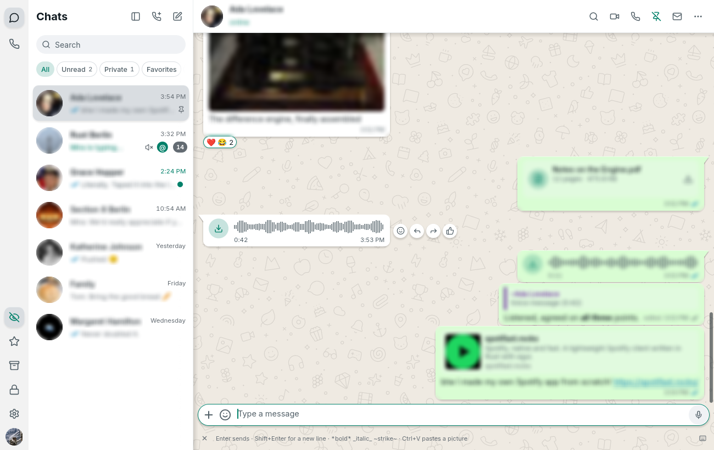
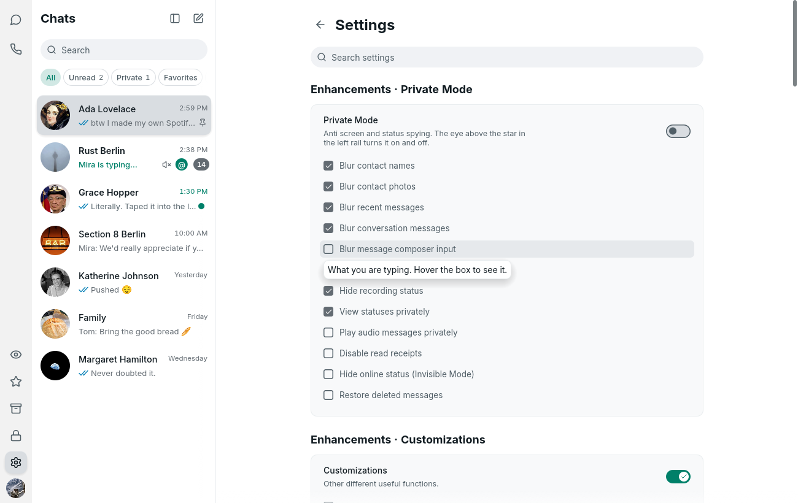

  

<h1 align="center">ZapFast Plus</h1>

  <a href="README.md">🇬🇧 English</a> · <strong>🇮🇩 Bahasa Indonesia</strong>

<strong>ZapFast, ditambah fitur privasi dan produktivitas ala WA Web Plus.</strong> 
Aplikasi WhatsApp native yang ringan untuk Windows (dibuat dengan Rust, tanpa browser), lengkap dengan menu <em>Enhancements</em>.

  <a href="https://github.com/profrendi/zplus/releases/latest"><strong>Unduh rilis terbaru</strong></a> ·
  <a href="#cara-pasang">Cara pasang</a> ·
  <a href="#fitur-yang-ditambahkan">Fitur yang ditambahkan</a> ·
  <a href="#sumber-asli-dan-kredit">Sumber asli</a>

> **ZapFast Plus adalah fork pribadi, bukan rilis resmi ZapFast.**
> Seluruh dasarnya adalah [ZapFast](https://github.com/crmne/zapfast) karya
> Carmine Paolino. Repo ini hanya menambahkan fitur di atasnya, dan otomatis
> mengikuti setiap rilis resmi ZapFast.

  

## Kenapa repo ini dibuat

ZapFast sudah sangat bagus: WhatsApp native, cepat, dan hemat memori. Yang
belum ada hanyalah fitur privasi dan produktivitas seperti di ekstensi browser
[WA Web Plus](https://www.wawplus.com/en#benefits) untuk WhatsApp Web. Karena
ZapFast tidak memakai browser, ekstensi itu tidak bisa dipasang. Jadi,
fitur-fiturnya dibuat ulang langsung di dalam kode ZapFast.

## Fitur yang ditambahkan

Semua pengaturan ada di **Settings → Enhancements** (paling atas), dibagi
menjadi tiga grup seperti di WA Web Plus. Setiap grup punya saklar utama dan
daftar pilihan yang bisa dicentang.

  

### Private Mode
| Fitur | Fungsinya |
|---|---|
| Blur nama kontak | Di daftar chat, hasil pencarian, dan header chat. Arahkan mouse ke situ untuk melihat. |
| Blur foto kontak | Foto profil di daftar chat, header, dan chat grup. |
| Blur pesan terakhir | Pratinjau pesan terakhir di daftar chat dan hasil pencarian. |
| Blur isi percakapan | Semua gelembung pesan di chat yang sedang dibuka. |
| Blur kotak ketik | Teks yang sedang kamu ketik. |
| Sembunyikan "mengetik…" | Orang lain tidak melihat kamu sedang mengetik. |
| Putar voice note diam-diam | Tanda "sudah diputar" (mikrofon biru) tidak dikirim. |
| Matikan centang biru | Tanda "sudah dibaca" tidak dikirim. |
| Invisible Mode | Kamu tidak pernah terlihat "online". |
| Pulihkan pesan yang dihapus | Pesan yang dihapus untuk semua orang tetap bisa dibaca, dengan tanda 🚫. |
| Tombol mata 👁 di sisi kiri | Menyalakan atau mematikan Private Mode dengan sekali klik; tombolnya juga bisa disembunyikan. |

Efek blur-nya benar-benar mengaburkan tampilan lewat GPU (shader OpenGL),
sama seperti `filter: blur()` di WA Web Plus, bukan sekadar ditutup kotak abu-abu.

### Customizations
| Fitur | Fungsinya |
|---|---|
| Notifikasi kontak online | Muncul notifikasi saat kontak dari chat terbaru mulai online. |
| Notifikasi mengetik/merekam | Muncul notifikasi saat seseorang mulai mengetik atau merekam di chat yang tidak sedang kamu buka. |
| Daftar chat tidak melompat | Chat yang baru kamu kirimi pesan tetap di posisinya sampai ada balasan. |

### Extra buttons
| Fitur | Fungsinya |
|---|---|
| Tombol Like 👍 | Kasih reaksi jempol sekali klik di samping pesan. |
| Tombol Translate 🌐 | Menerjemahkan pesan ke bahasa aplikasi lewat Google Translate (hanya pesan yang kamu klik yang dikirim). |
| Start new chat | Pilih kode negara, ketik nomornya, lalu langsung chat tanpa perlu menyimpan kontak. |
| Pin chat | Sematkan atau lepas sematan chat langsung dari header. |
| Tandai dibaca/belum dibaca | Tombol di header chat. |

Yang belum tersedia: transkripsi voice note (butuh mesin speech-to-text) dan
unduh status (ZapFast memang tidak menampilkan Status).

## Cara pasang

Unduh file-nya dari [halaman Releases](https://github.com/profrendi/zplus/releases/latest):

- **Installer**: `zapfast-v…-x86_64-pc-windows-msvc.msi`. Terpasang khusus untuk
  akun Windows kamu di `%LOCALAPPDATA%\Programs\ZapFast Plus`, **tanpa perlu hak
  admin**, lengkap dengan shortcut di Start menu dan desktop.
- **Portable**: `zapfast-v…-x86_64-pc-windows-msvc.zip`. Ekstrak di folder mana
  saja; data chat dan login disimpan di folder `zapfast-data` di sebelahnya.

ZapFast asli tidak perlu terpasang. Kalau ternyata sudah ada, keduanya memakai
login yang sama, tapi hanya satu yang bisa berjalan dalam satu waktu. Tutup
salah satunya dulu (ikon tray → Quit) sebelum membuka yang lain.

Windows SmartScreen mungkin memberi peringatan karena file-nya tidak memakai
sertifikat tanda tangan digital. Pilih *More info → Run anyway*.

## Cara kerja update

1. **Setiap hari**, workflow [`plus-sync`](.github/workflows/plus-sync.yml)
   mengecek apakah ada [rilis resmi ZapFast](https://github.com/crmne/zapfast/releases) yang baru.
2. Kalau ada, rilis itu digabungkan dengan fitur Plus. Setelah itu workflow
   [`plus-release`](.github/workflows/plus-release.yml) membuat installer dan
   versi portable, menandatangani `checksums.txt` (Ed25519), lalu menerbitkan
   rilisnya di repo ini.
3. ZapFast Plus di komputer kamu, baik versi installer maupun portable,
   mendeteksi rilis baru itu dan memperbarui dirinya sendiri. Fitur Plus tetap ada.
4. Kalau penggabungannya bentrok dengan perubahan di kode resmi, sebuah
   *issue* otomatis dibuat supaya bisa dibereskan secara manual.

Aturan nomor versi: `mayor.minor.(patch × 100 + revisi Plus)`. Contohnya,
ZapFast 0.21.1 dengan revisi Plus pertama menjadi **0.21.101**, dan ZapFast
0.21.2 nantinya menjadi 0.21.201.

## Untuk pengembang

- Kode fitur Plus: [`src/plus.rs`](src/plus.rs), [`src/ui/plus_new_chat.rs`](src/ui/plus_new_chat.rs),
  serta bagian kode yang diberi komentar `ZapFast Plus:` di folder `src/`.
- Pembuatan paket: folder [`plus/`](plus) (build Windows dari Linux dengan
  MinGW, installer MSI dengan `wixl`, dan zip portable).
- Catatan teknis singkat: [`PLUS.md`](PLUS.md).
- Panduan kontributor dari ZapFast asli tetap berlaku: [`AGENTS.md`](AGENTS.md),
  [`CONTRIBUTING.md`](CONTRIBUTING.md).

## Sumber asli dan kredit

- **ZapFast**: aplikasi yang menjadi dasar repo ini. Karya Carmine Paolino, berlisensi MIT.
  - Kode sumber: https://github.com/crmne/zapfast
  - Situs dan panduan: https://zapfast.rocks
  - README asli: https://github.com/crmne/zapfast#readme
- **WA Web Plus** dari Elbruz Technologies: inspirasi daftar fiturnya. Tidak ada
  kode dari ekstensi itu yang dipakai; semua fitur dibuat ulang dari nol.
  - https://www.wawplus.com
  - https://chromewebstore.google.com/detail/wa-web-plus-by-elbruz-tec/ekcgkejcjdcmonfpmnljobemcbpnkamh
- **whatsapp-rust**: pustaka protokol WhatsApp yang dipakai ZapFast,
  https://github.com/oxidezap/whatsapp-rust

## Lisensi dan penafian

Lisensinya sama dengan ZapFast: [MIT](LICENSE). Hak cipta aslinya tetap milik
Carmine Paolino; daftar komponen pihak ketiga ada di
[`THIRD-PARTY-NOTICES.md`](THIRD-PARTY-NOTICES.md).

ZapFast Plus tidak berafiliasi dengan WhatsApp, Meta, ZapFast, maupun WA Web Plus.
Fitur seperti menyembunyikan status online atau centang biru hanya mengatur apa
yang dikirim oleh aplikasi ini, jadi gunakan dengan bijak, ya.
