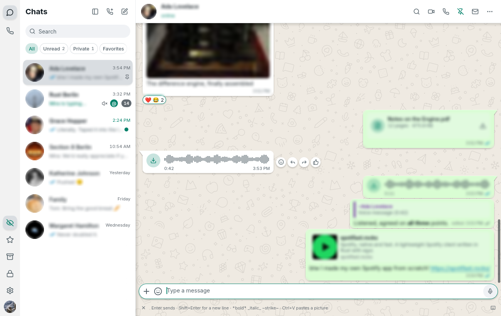
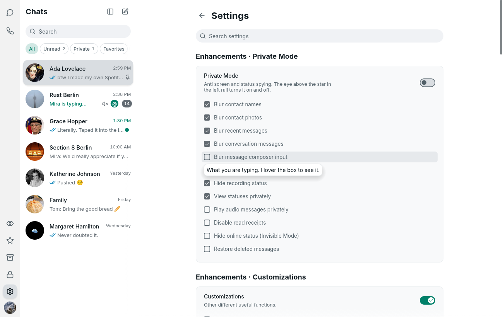

  

<h1 align="center">ZapFast Plus</h1>

<strong>ZapFast + the privacy and productivity features of WA Web Plus.</strong> 
<strong>ZapFast + fitur privasi dan produktivitas ala WA Web Plus.</strong>

  <a href="https://github.com/profrendi/zplus/releases/latest"><strong>Download / Unduh</strong></a>

<em>Choose your language below · Pilih bahasa di bawah ini</em>

<b>English (click to open or close)</b>

> **ZapFast Plus is a personal fork, not an official ZapFast release.**
> Everything it is built on is [ZapFast](https://github.com/crmne/zapfast) by
> Carmine Paolino. This repository only adds features on top, and follows every
> official ZapFast release automatically.

  

### Why this exists

ZapFast is already great: native WhatsApp, fast, and light on memory. What it
lacks are the privacy and productivity tools people get from the
[WA Web Plus](https://www.wawplus.com/en#benefits) browser extension for
WhatsApp Web. ZapFast has no browser, so the extension can't be installed —
instead, its features were rebuilt directly in ZapFast's code.

### What we added

Every option lives in **Settings → Enhancements** (at the top), in three groups
like WA Web Plus. Each group has a main switch and a list of checkboxes.

  

#### Private Mode
| Feature | What it does |
|---|---|
| Blur contact names | In the chat list, search results and chat header. Hover to reveal. |
| Blur contact photos | Profile pictures in the chat list, header and group chats. |
| Blur recent messages | The last-message preview in the chat list and search results. |
| Blur conversation messages | Every message bubble in the open chat. |
| Blur message composer | What you're typing. |
| Hide "typing…" | Others don't see you typing. |
| Play voice messages privately | The "played" receipt (blue microphone) isn't sent. |
| Disable read receipts | No blue ticks are sent. |
| Invisible Mode | You never show as "online". |
| Restore deleted messages | Messages deleted for everyone stay visible, marked with 🚫. |
| Eye button 👁 in the left rail | Turns Private Mode on and off in one click; can be hidden. |

The blur is a real GPU blur (an OpenGL shader), like `filter: blur()` in
WA Web Plus — not just a grey box on top.

#### Customizations
| Feature | What it does |
|---|---|
| Notify when contacts come online | A notification when someone from your recent chats comes online. |
| Notify about typing and recording | A notification when someone starts typing or recording in a chat you don't have open. |
| Chat list doesn't jump | A chat you just sent to keeps its place until someone replies. |

#### Extra buttons
| Feature | What it does |
|---|---|
| Like 👍 | React with a thumbs-up in one click, next to any message. |
| Translate 🌐 | Translates a message into the app's language with Google Translate (only the message you click is sent). |
| Start new chat | Pick a country code, type a number, and chat without saving the contact. |
| Pin chat | Pin or unpin the chat from its header. |
| Mark read/unread | A button in the chat header. |

Not available yet: voice message transcription (needs a speech-to-text engine)
and status downloads (ZapFast doesn't show Status).

### Install

Get the files from the [Releases page](https://github.com/profrendi/zplus/releases/latest):

- **Installer**: `zapfast-v…-x86_64-pc-windows-msvc.msi`. Installs for your user
  only, into `%LOCALAPPDATA%\Programs\ZapFast Plus`, **no admin rights needed**,
  with Start menu and desktop shortcuts.
- **Portable**: `zapfast-v…-x86_64-pc-windows-msvc.zip`. Unzip it anywhere; your
  chats and login are kept in a `zapfast-data` folder next to it.

You don't need the original ZapFast installed. If it is, both share the same
login, but only one can run at a time (quit one from its tray icon → Quit
before opening the other).

Windows SmartScreen may warn you because the files aren't signed with a
certificate: choose *More info → Run anyway*.

### How updates work

1. **Every day**, the [`plus-sync`](.github/workflows/plus-sync.yml) workflow
   checks for a new [official ZapFast release](https://github.com/crmne/zapfast/releases).
2. If there is one, it's merged with the Plus features, and the
   [`plus-release`](.github/workflows/plus-release.yml) workflow builds the
   installer and the portable zip, signs `checksums.txt` (Ed25519) and
   publishes a release here.
3. ZapFast Plus on your computer — installed or portable — sees the new
   release and updates itself, keeping the Plus features.
4. If the merge clashes with the official code, an issue is opened so it can be
   resolved by hand.

Version numbers: `major.minor.(patch × 100 + Plus revision)`. For example,
ZapFast 0.21.1 with the first Plus revision is **0.21.101**; ZapFast 0.21.2
becomes 0.21.201.

### For developers

- Plus features: [`src/plus.rs`](src/plus.rs), [`src/ui/plus_new_chat.rs`](src/ui/plus_new_chat.rs),
  and the code marked with `ZapFast Plus:` comments in `src/`.
- Packaging: the [`plus/`](plus) folder (Windows cross-build from Linux with
  MinGW, MSI installer with `wixl`, portable zip).
- Short technical notes: [`PLUS.md`](PLUS.md).
- ZapFast's own contributor guides still apply: [`AGENTS.md`](AGENTS.md),
  [`CONTRIBUTING.md`](CONTRIBUTING.md).

### Original sources and credits

- **ZapFast** — the app this is built on. By Carmine Paolino, MIT licence.
  - Source code: https://github.com/crmne/zapfast
  - Website and guides: https://zapfast.rocks
  - Original README: https://github.com/crmne/zapfast#readme
- **WA Web Plus** by Elbruz Technologies — the inspiration for the feature list.
  No code from the extension is used; the features were rebuilt from scratch.
  - https://www.wawplus.com
  - https://chromewebstore.google.com/detail/wa-web-plus-by-elbruz-tec/ekcgkejcjdcmonfpmnljobemcbpnkamh
- **whatsapp-rust** — the WhatsApp protocol library ZapFast uses:
  https://github.com/oxidezap/whatsapp-rust

### Licence and disclaimer

Same licence as ZapFast: [MIT](LICENSE). The original copyright stays with
Carmine Paolino; third-party components are listed in
[`THIRD-PARTY-NOTICES.md`](THIRD-PARTY-NOTICES.md).

ZapFast Plus is not affiliated with WhatsApp, Meta, ZapFast or WA Web Plus.
Features like hiding your online status or blue ticks only change what this
app sends — use them considerately.

<b>Bahasa Indonesia (klik untuk membuka atau menutup)</b>

> **ZapFast Plus adalah fork pribadi, bukan rilis resmi ZapFast.**
> Seluruh dasarnya adalah [ZapFast](https://github.com/crmne/zapfast) karya
> Carmine Paolino. Repo ini hanya menambahkan fitur di atasnya, dan otomatis
> mengikuti setiap rilis resmi ZapFast.

  

### Kenapa repo ini dibuat

ZapFast sudah sangat bagus: WhatsApp native, cepat, dan hemat memori. Yang
belum ada hanyalah fitur privasi dan produktivitas seperti di ekstensi browser
[WA Web Plus](https://www.wawplus.com/en#benefits) untuk WhatsApp Web. Karena
ZapFast tidak memakai browser, ekstensi itu tidak bisa dipasang. Jadi,
fitur-fiturnya dibuat ulang langsung di dalam kode ZapFast.

### Fitur yang ditambahkan

Semua pengaturan ada di **Settings → Enhancements** (paling atas), dibagi
menjadi tiga grup seperti di WA Web Plus. Setiap grup punya saklar utama dan
daftar pilihan yang bisa dicentang.

  

#### Private Mode
| Fitur | Fungsinya |
|---|---|
| Blur nama kontak | Di daftar chat, hasil pencarian, dan header chat. Arahkan mouse ke situ untuk melihat. |
| Blur foto kontak | Foto profil di daftar chat, header, dan chat grup. |
| Blur pesan terakhir | Pratinjau pesan terakhir di daftar chat dan hasil pencarian. |
| Blur isi percakapan | Semua gelembung pesan di chat yang sedang dibuka. |
| Blur kotak ketik | Teks yang sedang kamu ketik. |
| Sembunyikan "mengetik…" | Orang lain tidak melihat kamu sedang mengetik. |
| Putar voice note diam-diam | Tanda "sudah diputar" (mikrofon biru) tidak dikirim. |
| Matikan centang biru | Tanda "sudah dibaca" tidak dikirim. |
| Invisible Mode | Kamu tidak pernah terlihat "online". |
| Pulihkan pesan yang dihapus | Pesan yang dihapus untuk semua orang tetap bisa dibaca, dengan tanda 🚫. |
| Tombol mata 👁 di sisi kiri | Menyalakan atau mematikan Private Mode dengan sekali klik; tombolnya juga bisa disembunyikan. |

Efek blur-nya benar-benar mengaburkan tampilan lewat GPU (shader OpenGL),
sama seperti `filter: blur()` di WA Web Plus, bukan sekadar ditutup kotak abu-abu.

#### Customizations
| Fitur | Fungsinya |
|---|---|
| Notifikasi kontak online | Muncul notifikasi saat kontak dari chat terbaru mulai online. |
| Notifikasi mengetik/merekam | Muncul notifikasi saat seseorang mulai mengetik atau merekam di chat yang tidak sedang kamu buka. |
| Daftar chat tidak melompat | Chat yang baru kamu kirimi pesan tetap di posisinya sampai ada balasan. |

#### Extra buttons
| Fitur | Fungsinya |
|---|---|
| Tombol Like 👍 | Kasih reaksi jempol sekali klik di samping pesan. |
| Tombol Translate 🌐 | Menerjemahkan pesan ke bahasa aplikasi lewat Google Translate (hanya pesan yang kamu klik yang dikirim). |
| Start new chat | Pilih kode negara, ketik nomornya, lalu langsung chat tanpa perlu menyimpan kontak. |
| Pin chat | Sematkan atau lepas sematan chat langsung dari header. |
| Tandai dibaca/belum dibaca | Tombol di header chat. |

Yang belum tersedia: transkripsi voice note (butuh mesin speech-to-text) dan
unduh status (ZapFast memang tidak menampilkan Status).

### Cara pasang

Unduh file-nya dari [halaman Releases](https://github.com/profrendi/zplus/releases/latest):

- **Installer**: `zapfast-v…-x86_64-pc-windows-msvc.msi`. Terpasang khusus untuk
  akun Windows kamu di `%LOCALAPPDATA%\Programs\ZapFast Plus`, **tanpa perlu hak
  admin**, lengkap dengan shortcut di Start menu dan desktop.
- **Portable**: `zapfast-v…-x86_64-pc-windows-msvc.zip`. Ekstrak di folder mana
  saja; data chat dan login disimpan di folder `zapfast-data` di sebelahnya.

ZapFast asli tidak perlu terpasang. Kalau ternyata sudah ada, keduanya memakai
login yang sama, tapi hanya satu yang bisa berjalan dalam satu waktu. Tutup
salah satunya dulu (ikon tray → Quit) sebelum membuka yang lain.

Windows SmartScreen mungkin memberi peringatan karena file-nya tidak memakai
sertifikat tanda tangan digital. Pilih *More info → Run anyway*.

### Cara kerja update

1. **Setiap hari**, workflow [`plus-sync`](.github/workflows/plus-sync.yml)
   mengecek apakah ada [rilis resmi ZapFast](https://github.com/crmne/zapfast/releases) yang baru.
2. Kalau ada, rilis itu digabungkan dengan fitur Plus. Setelah itu workflow
   [`plus-release`](.github/workflows/plus-release.yml) membuat installer dan
   versi portable, menandatangani `checksums.txt` (Ed25519), lalu menerbitkan
   rilisnya di repo ini.
3. ZapFast Plus di komputer kamu, baik versi installer maupun portable,
   mendeteksi rilis baru itu dan memperbarui dirinya sendiri. Fitur Plus tetap ada.
4. Kalau penggabungannya bentrok dengan perubahan di kode resmi, sebuah
   *issue* otomatis dibuat supaya bisa dibereskan secara manual.

Aturan nomor versi: `mayor.minor.(patch × 100 + revisi Plus)`. Contohnya,
ZapFast 0.21.1 dengan revisi Plus pertama menjadi **0.21.101**, dan ZapFast
0.21.2 nantinya menjadi 0.21.201.

### Untuk pengembang

- Kode fitur Plus: [`src/plus.rs`](src/plus.rs), [`src/ui/plus_new_chat.rs`](src/ui/plus_new_chat.rs),
  serta bagian kode yang diberi komentar `ZapFast Plus:` di folder `src/`.
- Pembuatan paket: folder [`plus/`](plus) (build Windows dari Linux dengan
  MinGW, installer MSI dengan `wixl`, dan zip portable).
- Catatan teknis singkat: [`PLUS.md`](PLUS.md).
- Panduan kontributor dari ZapFast asli tetap berlaku: [`AGENTS.md`](AGENTS.md),
  [`CONTRIBUTING.md`](CONTRIBUTING.md).

### Sumber asli dan kredit

- **ZapFast**: aplikasi yang menjadi dasar repo ini. Karya Carmine Paolino, berlisensi MIT.
  - Kode sumber: https://github.com/crmne/zapfast
  - Situs dan panduan: https://zapfast.rocks
  - README asli: https://github.com/crmne/zapfast#readme
- **WA Web Plus** dari Elbruz Technologies: inspirasi daftar fiturnya. Tidak ada
  kode dari ekstensi itu yang dipakai; semua fitur dibuat ulang dari nol.
  - https://www.wawplus.com
  - https://chromewebstore.google.com/detail/wa-web-plus-by-elbruz-tec/ekcgkejcjdcmonfpmnljobemcbpnkamh
- **whatsapp-rust**: pustaka protokol WhatsApp yang dipakai ZapFast,
  https://github.com/oxidezap/whatsapp-rust

### Lisensi dan penafian

Lisensinya sama dengan ZapFast: [MIT](LICENSE). Hak cipta aslinya tetap milik
Carmine Paolino; daftar komponen pihak ketiga ada di
[`THIRD-PARTY-NOTICES.md`](THIRD-PARTY-NOTICES.md).

ZapFast Plus tidak berafiliasi dengan WhatsApp, Meta, ZapFast, maupun WA Web Plus.
Fitur seperti menyembunyikan status online atau centang biru hanya mengatur apa
yang dikirim oleh aplikasi ini, jadi gunakan dengan bijak, ya.

